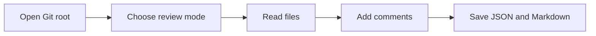

# Sample Markdown

A sample document for the **agentic-review desktop app**. Open this repository in **Full folder** mode, then select `examples/sample.md` to try the Markdown preview without modifying any files.

## Features

- Bullet lists and **strong text**
- `inline code`
- [A sample link](https://github.com) — links do not navigate away inside the app
- Tables and syntax-highlighted code blocks

## Available views

| File type | Views |
| --- | --- |
| Source code and JSON | Source; Diff in Git diff/commit mode |
| Markdown and HTML | Preview, Source; Diff in Git diff/commit mode |
| PNG, JPG/JPEG, WebP | Preview; before/after image comparison in Diff |

JSON is displayed as source, not as a collapsible tree. HTML is always sandboxed; there is no script-execution toggle.

## Code block

```python
def hello():
    return "Read locally, leave a comment, export feedback."
```

## Mermaid source

Mermaid fences are displayed as code, not rendered as diagrams:



## Images and appearance

Open `tests/fixtures/sample.png`, `tests/fixtures/sample.jpg`, or `tests/fixtures/sample.webp` directly from the file list to try image previews. The viewer offers **Fit** and **100%** controls. Relative or remote images embedded in Markdown/HTML are not fetched.

Use **Theme** and **Text size** in the app's top bar to change appearance. These settings are remembered independently of the opened repository.

> Click this block in Preview to anchor a comment to its starting source line. Adding a comment saves both `agentic-review.comments.json` and `agentic-review.comments.md` in the opened Git root.
